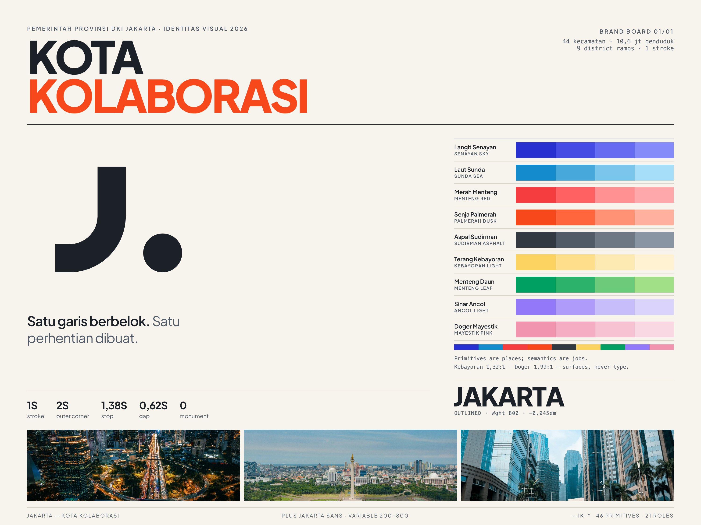

# Jakarta — Kota Kolaborasi

A city identity and design system for the Special Capital Region of Jakarta.

Open **`index.html`**. It is the whole thing: one file, no build step, no network
requests. Eight stops on the rail, from the city context to the audit.



## The idea

A city is a junction, not a monument.

The mark is one line that turns a corner and one stop where it turns. It is a **J**
because the name begins there; it is a junction because the argument begins there.
One stroke width (S), an outer corner of 2S, an inner corner of 1S, a stop of 1.38S
and a gap of 0.62S. Every measure in the family is a multiple of the first one, which
is why the drawing survives at 24px and at eight metres.

The palette is the client's, and it is a map: nine ramps named after Jakarta places —
Langit Senayan, Laut Sunda, Merah Menteng, Senja Palmerah, Aspal Sudirman, Terang
Kebayoran, Menteng Daun, Sinar Ancol, Doger Mayestik. Primitives are places. Semantics
are jobs. Nothing downstream names a hue.

## Read in this order

| File | What it is |
| --- | --- |
| `index.html` | the specimen. The primary artefact. |
| `brand/brief.md` | the six-line brief, the decisions, and what each one costs |
| `docs/jakarta-design-system-audit.md` | what is proved, by which command, and what is not |
| `brand/jakarta-board.png` | the board, 3000 × 2250 (1500 × 1125 at 2×) |
| `tokens/jakarta.tokens.css` | the token sheet — primitive, semantic, scale |
| `design/figma/jakarta/` | the Figma plugin and the .fig build script |

## Check it

```bash
node jakarta/scripts/build-tokens.mjs     # 14 pairs × 2 scopes, computed
node jakarta/scripts/verify-mark.mjs      # redraw vs supplied bitmap: 0.989 IoU
node jakarta/scripts/shots.mjs            # 1440 and 390, every section
node jakarta/scripts/figma-smoke.mjs jakarta/design/figma/jakarta/code.js
```

## Regenerate

Generated files are never edited by hand. Edit `src/tokens.json` or
`scripts/geometry.mjs`, then:

```bash
node jakarta/scripts/build-tokens.mjs   # tokens/*.css + *.json + docs/contrast.json
node jakarta/scripts/build-brand.mjs    # brand/*.svg + favicons
node jakarta/scripts/build.mjs          # index.html — inlines tokens, fonts, CSS, JS
node jakarta/scripts/render-board-png.mjs
```

The wordmark is outlined once from the variable TTF, then baked:

```bash
python3 jakarta/scripts/outline-wordmark.py \
  --font jakarta/assets/fonts/PlusJakartaSans-var.ttf \
  --wght 800 --text JAKARTA --track -0.045 \
  --out jakarta/src/wordmark.outline.svg \
  --metrics-out jakarta/brand/wordmark.metrics.json
```

## Licence

Plus Jakarta Sans is SIL Open Font License 1.1 (Tokotype / Google Fonts) and is
embedded as a subset. The photographs are Unsplash contributors' work, credited in
the file list. The mark is redrawn from the supplied bitmaps, which are kept in
`brand/_source-logo-black.png` and `brand/_source-logo-white.png` as provenance.
